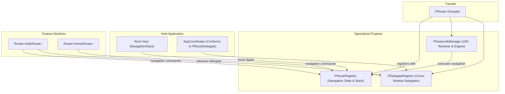

# PRouter

A lightweight, type-safe navigation and routing framework for **SwiftUI** built on top of modern `NavigationStack`.

`PRouter` is distributed as a pre-compiled binary **XCFramework** supporting **iOS** (Device & Simulator) and **macOS**.

`PRouter` simplifies multi-module navigation in SwiftUI applications by providing:
- **Type-Safe Routing**: Define feature destinations using clean, self-contained enums conforming to `PRoute`.
- **Shared Navigation State**: A centralized, observable `PRouteRegistry` managing SwiftUI's `NavigationPath`.
- **Deep Link Engine**: Built-in URL pattern matcher supporting path variables (e.g. `/products/:id`), query items, and rich navigation strategies (`.push`, `.replace`, `.replaceAll`, `.popUntilOrPush`, `.ignoreIfCurrent`, and `.custom`).
- **Cross-Module Communication**: Decouple isolated feature modules using `PRouteDelegate` (or `PRouteCoordinator`) to allow feature-to-host or inter-feature navigation without direct module dependencies.
- **Fluent Navigation API**: Ergonomic `push`, `replace`, `replaceAll`, `pop(count:)`, and `popToRoot` commands.

---

## Requirements

| Platform | Minimum Version | Architectures |
| :--- | :--- | :--- |
| **iOS** | 16.0+ | `arm64` (Device) & `arm64`, `x86_64` (Simulator) |
| **macOS** | 13.0+ | `arm64`, `x86_64` (Universal) |
| **Swift** | 5.9+ (Swift 6 compatible) | - |
| **Xcode** | 15.0+ | - |

---

## Installation

### Swift Package Manager (SPM)

#### Option 1: Via `Package.swift`

Add `PRouter` to your dependencies in `Package.swift`:

```swift
// swift-tools-version: 6.0
import PackageDescription

let package = Package(
    name: "MyApplication",
    platforms: [
        .iOS(.v16),
        .macOS(.v13)
    ],
    dependencies: [
        .package(url: "https://github.com/rahmat3nanda/PRouter.git", from: "1.0.0")
    ],
    targets: [
        .target(
            name: "MyApplication",
            dependencies: [
                .product(name: "PRouter", package: "PRouter")
            ]
        )
    ]
)
```

#### Option 2: Via Xcode

1. Open your project in Xcode.
2. Navigate to **File** > **Add Package Dependencies...**
3. Paste the repository URL: `https://github.com/rahmat3nanda/PRouter.git`
4. Set the dependency rule (e.g. `Up to Next Major Version` from `1.0.0`).
5. Choose your target and click **Add Package**.

---

## Example Project

A complete sample application demonstrating multi-module architecture, coordinators, and deep linking is available at:
👉 **[PRouter-Example](https://github.com/rahmat3nanda/PRouter-Example)**

---

## Architecture Overview



### Architecture Highlights
- **`PRouteRegistry` (Single Responsibility)**: Pure navigation state store holding SwiftUI's `NavigationPath` and mirrored `routes` stack.
- **`PDeepLinkManager`**: Dedicated URL pattern matcher supporting parameters (`:id`), query parsing, and 6 navigation strategies (`.push`, `.replace`, `.replaceAll`, `.popUntilOrPush`, `.ignoreIfCurrent`, `.custom`).
- **`PDelegateRegistry`**: Dedicated thread-safe registry for cross-module delegate & coordinator instances.
- **`PRouter` (Facade)**: Convenient top-level access (`PRouter.store`, `PRouter.deepLink`, `PRouter.delegates`, `PRouter.handle(...)`).
- **`Router<Route>`**: Lightweight client used inside Views and ViewModels.

### Type Aliases & Architecture Conventions

| Alias | Original Type | Purpose |
| :--- | :--- | :--- |
| `PRouteCoordinator` | `PRouteDelegate` | Semantic alias for teams adopting the Coordinator pattern. |
| `PCoordinatorRegistry` | `PDelegateRegistry` | Semantic alias for coordinator registry. |
| `PRootView` | `PRouterRootView` | Concise view wrapper alias. |

---

## Quick Start Guide

### 1. Define Routes

Declare your feature routes conforming to `PRoute`. Each case returns its corresponding SwiftUI destination view:

```swift
import SwiftUI
import PRouter

public enum AuthRoute: PRoute {
    case login
    case register
    case forgotPassword(email: String)

    @ViewBuilder
    public func destination() -> some View {
        switch self {
        case .login:
            LoginView()
        case .register:
            RegisterView()
        case .forgotPassword(let email):
            ForgotPasswordView(email: email)
        }
    }
}
```

> [!TIP]
> Routes conform to `Hashable` and automatically generate a URL-style default path (e.g. `/login`). You can customize the identifier by overriding `path`.

---

### 2. Connect the Root Navigation Stack

At your root application view, bind `NavigationStack` to `PRouteRegistry.shared.path` and register each feature's routes using `.registerRoutes(...)`:

```swift
import SwiftUI
import PRouter

struct ContentView: View {
    @StateObject private var routerStore = PRouteRegistry.shared

    var body: some View {
        NavigationStack(path: $routerStore.path) {
            HomeView()
                .registerRoutes(for: AuthRoute.self)
                .registerRoutes(for: ProfileRoute.self)
        }
    }
}
```

---

### 3. Navigate from Views or ViewModels

Instantiate a `Router<Route>` inside any view or view model to perform navigation actions:

```swift
import SwiftUI
import PRouter

struct LoginView: View {
    private let router = Router<AuthRoute>()

    var body: some View {
        VStack(spacing: 16) {
            Button("Go to Register") {
                router.push(.register)
            }

            Button("Reset Password") {
                router.push(.forgotPassword(email: "user@example.com"))
            }

            Button("Back") {
                router.pop()
            }
        }
    }
}
```

---

### 4. Cross-Module Navigation with `PRouteDelegate`

When isolated feature modules (e.g. `AuthModule`) cannot directly import or depend on other feature modules (e.g. `DashboardModule`), use **route delegates**:

#### Define the delegate in the feature module:
```swift
import PRouter

@MainActor
public protocol AuthRouteDelegate: PRouteDelegate {
    func didCompleteLogin()
    func didRequestHelp()
}
```

#### Trigger the delegate inside the feature:
```swift
struct LoginViewModel {
    private let router = Router<AuthRoute>()

    func handleLoginSuccess() {
        router.delegate(AuthRouteDelegate.self)?.didCompleteLogin()
    }
}
```

#### Implement and register the delegate in the host app:
```swift
final class AppCoordinator: AuthRouteDelegate {
    private let homeRouter = Router<HomeRoute>()

    func didCompleteLogin() {
        // Transition to home flow
        homeRouter.replaceAll(with: .dashboard)
    }

    func didRequestHelp() {
        homeRouter.push(.support)
    }
}

// In your app bootstrap / startup:
let coordinator = AppCoordinator()
PRouter.delegates.register(coordinator)
// (or PDelegateRegistry.shared.register(coordinator))
```

---

### 5. Deep Linking Support

PRouter provides a built-in deep link engine that matches custom schemes (e.g. `myapp://...`) or Universal Links (e.g. `https://domain.com/...`) with path variables (`/:id`) and query parameters:

#### Option A: Conforming to `PDeepLinkRoute`
```swift
public enum ProductRoute: PDeepLinkRoute {
    case list
    case detail(id: String, promo: String?)

    // Pattern with dynamic path variable:
    public static var urlPattern: String {
        "/products/:id"
    }

    public static func resolve(from url: URL, parameters: [String: String]) -> ProductRoute? {
        if let id = parameters["id"] {
            return .detail(id: id, promo: parameters["promo"])
        }
        return nil
    }

    @ViewBuilder
    public func destination() -> some View {
        switch self {
        case .list: ProductListView()
        case .detail(let id, let promo): ProductDetailView(productId: id, promo: promo)
        }
    }
}

// Register with PRouter facade:
PRouter.registerDeepLink(ProductRoute.self)
// (or PDeepLinkManager.shared.register(ProductRoute.self))
```

#### Option B: Pattern Closure Registration
```swift
PRouter.registerDeepLink(pattern: "/settings/:section") { url, params in
    SettingsRoute.section(params["section"] ?? "general")
}
// (or PDeepLinkManager.shared.register(pattern: "/settings/:section") { ... })
```

#### Handling Deep Links in SwiftUI
Attach `.onDeepLink()` to your root view:
```swift
struct ContentView: View {
    @StateObject private var routerStore = PRouteRegistry.shared

    var body: some View {
        NavigationStack(path: $routerStore.path) {
            HomeView()
                .registerRoutes(for: ProductRoute.self)
        }
        .onDeepLink(strategy: .push) { unhandledURL in
            // Handle external or fallback URL
        }
    }
}
```

Or trigger manually:
```swift
PRouter.handle(url: incomingURL, strategy: .replaceAll)
// (or PDeepLinkManager.shared.handle(url: incomingURL, strategy: .replaceAll))
```

---

## Navigation Operations Reference

| Method | Description |
| :--- | :--- |
| `router.push(route)` / `router.push(path)` | Appends a destination onto the stack via concrete route or path/URL string. |
| `router.replace(with: route)` / `router.replace(with: path)` | Replaces the top destination on the stack with a route or path/URL string. |
| `router.replaceAll(with: route)` / `router.replaceAll(with: path)` | Resets the stack and sets the given route or path/URL string as the sole destination. |
| `router.pop(count:)` | Pops `count` destinations from the navigation stack (defaults to 1). |
| `router.popUntil(route)` / `router.popUntil(path)` | Pops destinations until the specified route or path string is at the top of the stack. |
| `router.popUntil(where:)` | Pops destinations until a route matching the closure predicate is reached. |
| `router.popToRoot()` | Clears all destinations in the navigation path, returning to the root view. |
| `router.current` | Returns the currently active destination matching the router's route type. |
| `PRouter.current` | Returns the currently active top destination or root route across all modules. |
| `store.routes` | Mirrored array of active route destinations currently on the navigation stack. |
| `router.routeRegistry` | Direct access to the shared `PRouteRegistry` instance from the router. |
| `router.delegateRegistry` | Direct access to the shared `PDelegateRegistry` instance from the router. |
| `router.register(delegate)` | Registers a `PRouteDelegate` (or `PRouteCoordinator`) instance in the delegate registry. |
| `router.delegate(Type.self)` / `router.delegate()` | Retrieves the registered delegate using explicit type or automatic type inference. |
| `PRouter.registerDeepLink(...)` | Registers a `PDeepLinkRoute` or URL pattern closure for deep link resolution. |
| `PRouter.handle(url:strategy:)` | Resolves and navigates using `.push`, `.replace`, `.replaceAll`, `.popUntilOrPush`, `.ignoreIfCurrent`, or `.custom`. |
| `.registerRoutes(for: Route.self)` | View modifier registering destination views for a route type. |
| `.onDeepLink(...)` | View modifier listening for incoming URLs via `.onOpenURL` and triggering navigation. |

---

## License

This project is licensed under the MIT License - see the [LICENSE](LICENSE) file for details.
